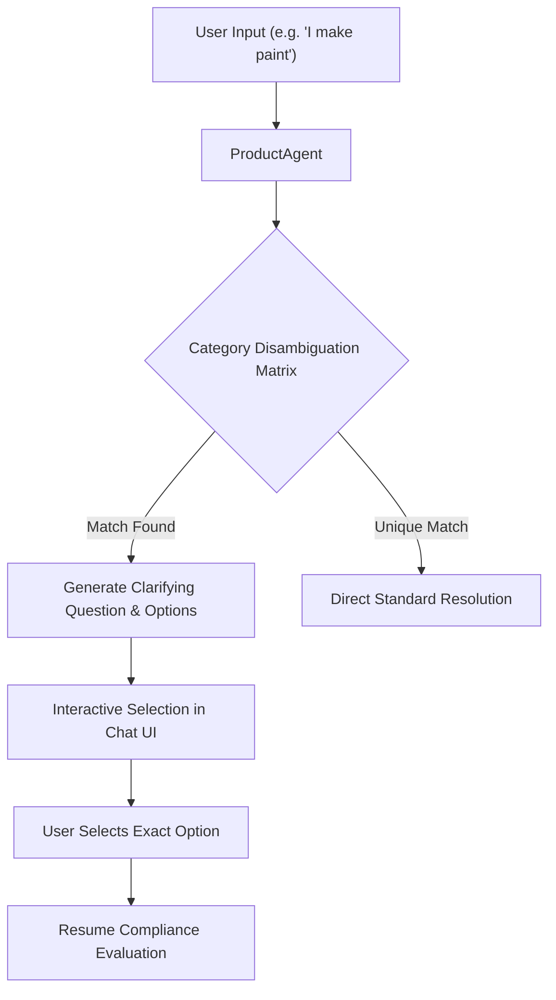

# Product Disambiguation & Follow-up Agent

## Purpose
Users frequently describe products using generic or broad terms (such as *"paint"*, *"helmet"*, *"geyser"*, *"cooker"*). The `ProductAgent` intercepts ambiguous terms, identifies multiple possible applicable standards, and formulates interactive follow-up questions to resolve the exact product category before committing to regulatory advice.

---

## System Architecture



---

## Data Flow

### Step 1: Broad Category Detection
- **Purpose**: Compare extracted product terms against known ambiguous statutory categories.
- **Input**: Product keyword string.
- **Output**: Matched category config from `PRODUCT_CATEGORIES_DISAMBIGUATION`.
- **Hook**: `product_agent.check_ambiguity(product)`

### Step 2: Fetch Options & Standard Candidates
- **Purpose**: Retrieve candidate standards, titles, and mandatory QCO flags for the ambiguous category.
- **Input**: Category key (e.g. `"paint"`).
- **Output**: List of options:
  - Option 1: Marking Paint (IS 138:2018)
  - Option 2: Synthetic Enamel Paint (IS 2932:2013)
- **Hook**: `product_agent.get_disambiguation_options()`

### Step 3: Run Interactive Clarification Modal
- **Purpose**: Format a user-friendly conversational response containing clickable follow-up chips.
- **Input**: Disambiguation options list.
- **Output**: Structured response payload with `needs_clarification: true`.
- **Hook**: `response_agent.format_clarification()`

---

## Component Types

| Category | Example Query | Disambiguation Question | Candidate Standards |
| :--- | :--- | :--- | :--- |
| **Paints** | *"paint"* | *"Which type of paint do you produce or wish to certify?"* | `IS 138:2018`, `IS 2932:2013` |
| **Helmets** | *"helmet"* | *"Which category does your helmet product fall under?"* | `IS 4151:2020` (Motorcycle), `IS 2925:1984` (Industrial) |
| **Geysers** | *"water heater"* | *"Which type of water heater do you manufacture?"* | `IS 302-2-21:2018` (Storage), `IS 302-2-35` (Instantaneous) |
| **Cookers** | *"cooker"* | *"What category of pressure cooker are you inquiring about?"* | `IS 2347:2017` (Domestic / Commercial) |

---

## Model Selection (3 Models Only)

### 1. Keyword Disambiguation Map
- **Model**: In-memory Hash Table lookup
- **Purpose**: Instantaneous detection of ambiguous product stems.
- **Input**: Normalized product string.
- **Output**: Disambiguation dictionary.
- **Hook**: `product_agent.disambiguate()`

### 2. Semantic Product Embedder
- **Model**: `all-MiniLM-L6-v2`
- **Purpose**: Matches unlisted synonyms to known ambiguous stems (e.g. *"varnish"* to *"paint"*).
- **Input**: Query vector.
- **Output**: Cosine similarity to category prototypes.
- **Hook**: `product_agent.find_closest_category()`

### 3. Follow-up Synthesis Engine
- **Model**: Template and Gemini Prompt Generator
- **Purpose**: Formulates natural follow-up questions adapted to user language.
- **Input**: Options payload and language.
- **Output**: Localized question string.
- **Hook**: `response_agent.generate_response()`

---

## State Management

```typescript
export interface DisambiguationOption {
  label: string;
  standard: string;
  query: string;
  mandatory: boolean;
}

export interface DisambiguationState {
  isDisambiguating: boolean;
  categoryTitle: string;
  clarificationQuestion: string;
  options: DisambiguationOption[];
}
```

---

## Key Interactions

### 1. User Clicks Disambiguation Chip
- When the user clicks `"Marking Paint (IS 138)"`, the frontend sends the synthetic query:
  `"What standard applies to marking paint for packages and petrol containers?"`
- The system immediately bypasses disambiguation and returns the authoritative standard details.

---

## File Structure

```text
backend/agents/
└── product_agent.py      # ProductAgent & PRODUCT_CATEGORIES_DISAMBIGUATION
```

---

## Integration Points

### Existing Hooks (Reuse)
- `ProductAgent.resolve_product(product_name)`
- `ProductAgent.get_disambiguation_options(category)`
