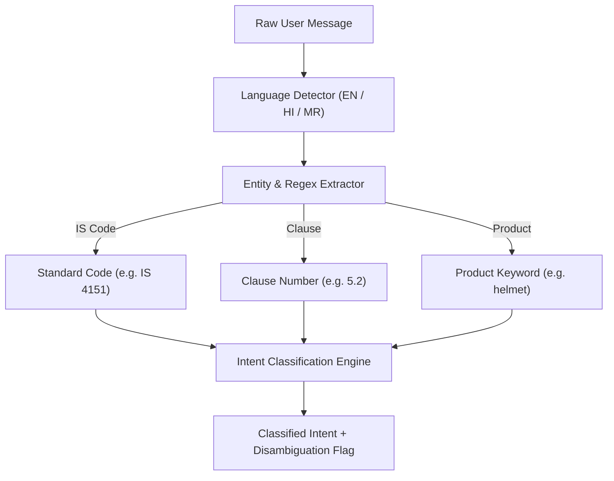

# Query Agent & Intent Classification

## Purpose
The `QueryAgent` is the front-line cognitive parser of the assistant. It extracts statutory entities, detects linguistic signals across English, Hindi, and Marathi, and classifies requests into 16 distinct operational intents.

---

## System Architecture



---

## Data Flow

### Step 1: Language Detection
- **Purpose**: Identify whether the query is in English, Hindi, or Marathi using Unicode script ranges.
- **Input**: Query text string.
- **Output**: Language code (`en`, `hi`, `mr`).
- **Hook**: `query_agent.detect_language()`

### Step 2: Entity & Regex Extraction
- **Purpose**: Parse statutory designations (`IS 4151`), clause numbers (`clause 5.2`), and product keywords.
- **Input**: Cleaned query.
- **Output**: Structured entity dictionary.
- **Hook**: `query_agent.extract_entities()`

### Step 3: Intent Classification
- **Purpose**: Map the query to one of the 16 BIS Action Intents.
- **Input**: Query and Extracted Entities.
- **Output**: Primary intent string.
- **Hook**: `query_agent.classify_intent()`

---

## Component Types

| Component | Responsibility | Performance |
| :--- | :--- | :--- |
| **Language Classifier** | Unicode script inspection | &lt; 0.1 ms |
| **Entity Extractor** | Regex parser for IS standards | &lt; 0.5 ms |
| **Intent Classifier** | Deterministic keyword and semantic heuristics | &lt; 1.0 ms |

---

## Model Selection (3 Models Only)

### 1. Unicode Script Range Model
- **Model**: Devanagari Unicode Block Detector
- **Purpose**: Fast-path multilingual routing.
- **Input**: String.
- **Output**: Language identifier.
- **Hook**: `detect_script()`

### 2. Statutory Entity Model
- **Model**: Regex Pattern Matcher
- **Purpose**: Exact extraction of standard codes.
- **Input**: String.
- **Output**: Standard code.
- **Hook**: `extract_standard_number()`

### 3. Intent Taxonomy Router
- **Model**: Rule-based priority tree with LLM fallback
- **Purpose**: Dispatches query to corresponding subagent.
- **Input**: Analyzed dictionary.
- **Output**: Intent enum.
- **Hook**: `query_agent.analyze()`

---

## State Management

```typescript
export interface QueryAnalysisResult {
  intent: 'STANDARD_DISCOVERY' | 'MANDATORY_STATUS' | 'TEST_REQUIREMENTS' | 'CLAUSE_QUERY' | 'LABORATORY_SEARCH' | 'HALLMARKING';
  language: 'en' | 'hi' | 'mr';
  standardNumber: string | null;
  clauseNumber: string | null;
  product: string | null;
  needsClarification: boolean;
  clarificationMessage: string | null;
}
```

---

## Key Interactions

### 1. Multilingual Query
- Input: *"मोटरसाइकिल हेलमेट के लिए कौन सा मानक लागू होता है?"*
- Language: `hi`
- Intent: `STANDARD_DISCOVERY`
- Standard: `IS 4151:2020`

---

## File Structure

```text
backend/agents/
└── query_agent.py         # QueryAgent implementation
```

---

## Integration Points

### Existing Hooks (Reuse)
- `query_agent.analyze(query, context)`
