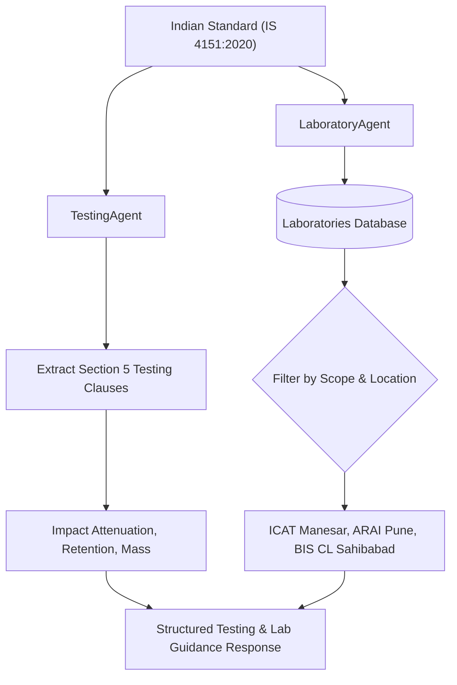

# Testing & Laboratory Agents

## Purpose
The `TestingAgent` and `LaboratoryAgent` extract required tests, sample sizes, and pass/fail thresholds directly from standard clauses, and locate accredited BIS Central, Regional, Branch, and Recognized private laboratories with matching testing scopes.

---

## System Architecture



---

## Data Flow

### Step 1: Standard Parameter Extraction
- **Purpose**: Parse testing parameters, clause numbers, and quantitative acceptance thresholds from standard chunks.
- **Input**: Standard number.
- **Output**: Structured list of required tests.
- **Hook**: `testing_agent.get_tests(standard_number)`

### Step 2: Laboratory Scope Filtering
- **Purpose**: Query `laboratories` table for facilities holding NABL/BIS accreditation for the specific IS code.
- **Input**: Standard code and optional user location.
- **Output**: List of verified testing laboratories.
- **Hook**: `lab_repo.find_labs_for_standard(standard_number)`

### Step 3: Geographic Sorting & Contact Assembly
- **Purpose**: Order testing laboratories by administrative tier (Central Lab &gt; Regional Lab &gt; Recognized Lab).
- **Input**: Filtered laboratory list.
- **Output**: Ranked laboratory cards with address, phone, email, and portal links.
- **Hook**: `lab_agent.format_lab_directory()`

---

## Component Types

| Laboratory Name | Location | Accreditation Scope | Lab Type |
| :--- | :--- | :--- | :--- |
| **BIS Central Laboratory** | Sahibabad, Ghaziabad, UP | Comprehensive electrical, chemical, mechanical | BIS Central |
| **ICAT (International Centre for Automotive Technology)** | Manesar, Gurugram, Haryana | IS 4151 (Helmets), IS 2553 (Safety Glass) | Recognized |
| **ARAI (Automotive Research Association of India)** | Pune, Maharashtra | IS 4151 (Helmets), CMVR Automotive Components | Recognized |
| **BIS Western Regional Office Laboratory** | Andheri East, Mumbai | Consumer products, domestic appliances | BIS Regional |

---

## Model Selection (3 Models Only)

### 1. Clause Threshold Extractor
- **Model**: Regular Expression and Pattern Matcher for Units
- **Purpose**: Extracts exact numeric criteria from test clauses.
- **Input**: Clause text.
- **Output**: Parameter name and threshold value.
- **Hook**: `testing_agent.extract_thresholds()`

### 2. Laboratory Scope Indexer
- **Model**: Relational SQL Scope Filter
- **Purpose**: Matches IS codes against laboratory accreditation schedules.
- **Input**: IS Number.
- **Output**: Accredited lab records.
- **Hook**: `lab_repo.get_by_scope()`

### 3. Contact & Accreditation Formatter
- **Model**: Template Builder
- **Purpose**: Outputs markdown cards with verified BIS LIMS portal links.
- **Input**: Lab entity.
- **Output**: Markdown snippet.
- **Hook**: `lab_agent.render_card()`

---

## State Management

```typescript
export interface LaboratoryRecord {
  id: number;
  name: string;
  code: string;
  city: string;
  state: string;
  type: 'BIS_CENTRAL' | 'BIS_REGIONAL' | 'BIS_BRANCH' | 'RECOGNIZED';
  accreditedStandards: string[];
  contactEmail: string;
  contactPhone: string;
}
```

---

## Key Interactions

### 1. Helmet Lab Inquiry
- Query: *"Where can I get motorcycle helmets tested?"*
- Result: Returns ICAT Manesar, ARAI Pune, and BIS Central Laboratory Sahibabad with exact accredited scopes.

---

## File Structure

```text
backend/
├── agents/
│   ├── testing_agent.py
│   └── laboratory_agent.py
└── database/
    ├── models/laboratory.py
    └── repositories/lab_repo.py
```

---

## Integration Points

### Existing Hooks (Reuse)
- `testing_agent.get_tests_for_standard(standard_number)`
- `lab_agent.find_laboratories(standard_number, location)`
