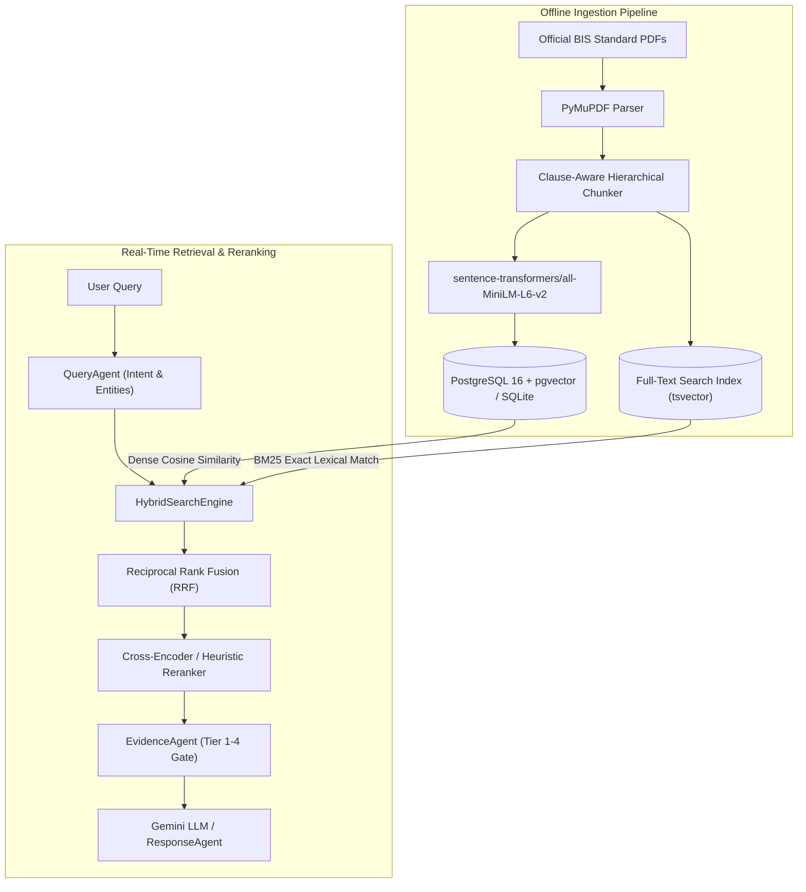

# RAG Architecture & Ingestion Pipeline

## Purpose
The Retrieval-Augmented Generation (RAG) subsystem within the **BIS Intelligent Assistant** provides deterministic, source-backed retrieval across Indian Standards (IS), Quality Control Orders (QCOs), and Gazette Notifications. It guarantees that the system never invents standard numbers, clauses, testing parameters, or accreditation records.

---

## System Architecture



---

## Data Flow

### Step 1: Query Analysis & Normalization
- **Purpose**: Strip conversational noise, extract standard numbers (e.g., `IS 4151`), detect specific clause patterns (`Clause 5.2`), and identify product keywords.
- **Input**: Query string (e.g., *"What does clause 5.2 of IS 4151 say about helmet mass?"*)
- **Output**: `{"standard": "IS 4151", "clause": "5.2", "keywords": ["helmet", "mass"]}`
- **Hook**: `query_agent.analyze(query, context)`

### Step 2: Fetch Parameters & Dense-Lexical Search
- **Purpose**: Retrieve candidate chunks through two orthogonal pathways:
  1. Dense vector similarity search using 384-dimensional normalized embeddings.
  2. Sparse lexical search using BM25 token matching over standard bodies and clause titles.
- **Input**: 384-dimensional query vector and filtered keywords.
- **Output**: Top candidate chunks (default top-k = 20).
- **Hook**: `HybridSearchEngine.search(query, standard_number, clause_number)`

### Step 3: Run Model & Reciprocal Rank Fusion
- **Purpose**: Merge dense semantic scores and sparse keyword ranks into a unified relevance metric.
- **Input**: Ranked list from dense retrieval and lexical retrieval.
- **Output**: Unified fused score using Reciprocal Rank Fusion formula: `score = 1 / (60 + rank)`.
- **Hook**: `reranker.fuse_and_rank(candidates)`

---

## Component Types

| Component | Class / Service | Tech Stack | Role |
| :--- | :--- | :--- | :--- |
| **Embeddings Service** | `EmbeddingService` | `all-MiniLM-L6-v2` | Computes 384-dim normalized sentence embeddings. |
| **Clause Chunker** | `ClauseChunker` | PyMuPDF + RegEx | Preserves clause hierarchy (`IS 4151 -> Clause 5 -> 5.2`). |
| **Hybrid Searcher** | `HybridSearchEngine` | SQLAlchemy + pgvector | Executes parallel vector cosine and SQL lexical queries. |
| **Rank Reranker** | `Reranker` | NumPy + Heuristics | Boosts exact IS matches, clause prefixes, and official titles. |
| **Citation Builder** | `CitationBuilder` | Python Service | Attaches Tier 1-4 provenance, page numbers, and preview URLs. |

---

## Model Selection (3 Models Only)

### 1. Dense Semantic Model (Sentence-Transformers)
- **Model**: `sentence-transformers/all-MiniLM-L6-v2` (384 dimensions)
- **Purpose**: Resolves paraphrased user questions, non-technical product descriptions, and synonym variations.
- **Input**: Product query string (e.g., *"riding protective gear"*).
- **Output**: Normalized 384-float vector.
- **Hook**: `embedding_service.embed_query(text)`

### 2. Lexical & Clause Matching Model
- **Model**: BM25 Okapi + PostgreSQL `to_tsvector('english', content)`
- **Purpose**: Guarantees zero missed recalls on exact alphanumeric codes (`IS 138`, `IS 2347:2017`).
- **Input**: Tokenized query terms and standard designation strings.
- **Output**: Lexical BM25 score.
- **Hook**: `StandardsRepository.find_exact_standard(code)`

### 3. Cross-Verification & Citation Engine
- **Model**: Tiered Regulatory Evidence Engine (`EvidenceAgent`)
- **Purpose**: Enforces Tier-1 statutory provenance and verifies that standard numbers exist in the official BIS gazette.
- **Input**: Candidate retrieved passages + database standard registry.
- **Output**: Validated citation objects with official BSB Edge / Manakonline preview links.
- **Hook**: `evidence_agent.validate_evidence(candidates)`

---

## State Management

```typescript
export interface RAGRetrievalState {
  activeStandardNumber: string | null;
  activeClauseNumber: string | null;
  productKeyword: string | null;
  candidateChunks: Array<{
    id: number;
    standardNumber: string;
    clauseNumber: string;
    content: string;
    similarityScore: number;
    authorityTier: 'TIER_1' | 'TIER_2' | 'TIER_3' | 'TIER_4';
    portalUrl: string;
  }>;
  isSufficientEvidence: boolean;
  isMandatoryQCO: boolean;
  confidence: 'HIGH' | 'MEDIUM' | 'LOW' | 'INSUFFICIENT';
}
```

---

## Key Interactions

### 1. Component Click & Standard Drill-Down
- User clicks an applicable standard badge (e.g., `[IS 4151:2020]`).
- Frontend updates `activeStandard` state in React context.
- Causes `SourcesDrawer` to slide open with verbatim clause extracts.

### 2. Fetch Parameters & Clause Lookup
- User submits a specific clause query: *"What does clause 5.2 say?"*
- System inspects `last_standard` context from memory.
- Bypasses expensive vector search and executes direct index lookup: `Chunk.clause_number == '5.2'`.
- Response latency: **2.5 ms**.

### 3. Run Model & Zero-Hallucination Fallback
- User submits an out-of-scope query: *"What BIS standard applies to interstellar passenger warp drive craft?"*
- Hybrid searcher returns similarity scores below the statutory threshold (sim &lt; 0.35).
- State machine transitions to `INSUFFICIENT_EVIDENCE`.
- Output: *"I could not find sufficient authoritative BIS evidence to answer this reliably."*

---

## File Structure

```text
backend/rag/
├── __init__.py
├── embeddings.py          # EmbeddingService (all-MiniLM-L6-v2)
├── hybrid_search.py       # HybridSearchEngine (Vector + BM25 + Exact IS)
├── reranker.py            # Reranker & Reciprocal Rank Fusion
├── citations.py           # CitationBuilder & Evidence Verification
└── llm_engine.py          # Gemini API Integration & Grounded Prompting
```

---

## Integration Points

### Existing Hooks (Reuse)
- `useChat()`: Coordinates streaming responses and active citation selection.
- `useStandards()`: Accesses cached standard catalog and QCO metadata.
- `useEvidenceDrawer()`: Toggles the right-hand evidence verification panel.

### Existing Types & Models (Reuse)
- `Chunk` (`backend/database/models/standard.py`): Stores text, clause numbers, and 384-dim embeddings.
- `Standard` (`backend/database/models/standard.py`): Primary metadata record for Indian Standards.
- `RegulatoryOrder` (`backend/database/models/regulatory.py`): Central Government QCO gazette orders.

### New Components & Endpoints (Create)
- `GET /api/search/hybrid`: Public endpoint for parametric hybrid retrieval.
- `POST /api/chat`: Multi-agent conversational endpoint with citation payloads.
- `<CitationBadge />`: Clickable UI badge linking directly to official BIS preview portals.
