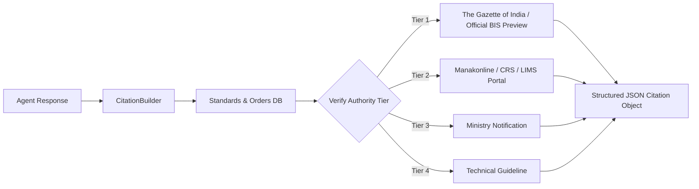

# Citation Engine & Statutory Evidence Provenance

## Purpose
The Citation Engine provides cryptographic and database-backed proof for every regulatory assertion made by the assistant. It formats citations with authority tiers (Tiers 1 to 4), clause numbers, page numbers, and direct preview links to official Government of India and BIS portals.

---

## System Architecture



---

## Data Flow

### Step 1: Extraction of Assertions & Citations
- **Purpose**: Map claims in the generated response back to underlying retrieved database chunks.
- **Input**: Generated response text and candidate chunks.
- **Output**: Linked citation anchors.
- **Hook**: `CitationBuilder.build_citations()`

### Step 2: Assign Authority Tiers
- **Purpose**: Enforce the 4-tier statutory authority hierarchy:
  - **Tier 1**: Official Indian Standards, Acts, Quality Control Orders (QCOs) in The Gazette of India.
  - **Tier 2**: Official BIS Portals (`standardsbis.bsbedge.com`, `manakonline.in`).
  - **Tier 3**: Central Ministry Circulars (MoRTH, DPIIT, MeitY).
  - **Tier 4**: Third-Party or Academic References.
- **Input**: Source document type.
- **Output**: Tier classification string.
- **Hook**: `evidence_agent.classify_tier()`

### Step 3: Generate Deep Preview Hyperlinks
- **Purpose**: Construct verifiable URLs pointing directly to official BIS standard preview pages or gazette archives.
- **Input**: Standard number (e.g. `IS 4151:2020`).
- **Output**: Official BSB Edge URL.
- **Hook**: `CitationBuilder.format_portal_url()`

---

## Component Types

| Component | Responsibility | Output Format |
| :--- | :--- | :--- |
| **CitationBuilder** | Assembles citation payload | JSON metadata object |
| **EvidenceAgent** | Validates provenance and forbids unbacked statements | Boolean pass/fail validation |
| **PortalLinker** | Formats official BIS web links | Absolute HTTPS URL |

---

## Model Selection (3 Models Only)

### 1. Provenance Verification Model
- **Model**: Deterministic Foreign Key Lookup
- **Purpose**: Verifies that every cited chunk ID exists in the database.
- **Input**: Chunk ID.
- **Output**: Verified database record.
- **Hook**: `chunks_repo.get_by_id()`

### 2. Authority Tier Classifier
- **Model**: Statutory Source Taxonomy Rule Engine
- **Purpose**: Assigns authority level based on publisher and legal gazette status.
- **Input**: Document metadata.
- **Output**: Tier indicator (`TIER_1`, `TIER_2`, `TIER_3`, `TIER_4`).
- **Hook**: `evidence_agent.get_tier()`

### 3. Citation Renderer
- **Model**: Markdown Citation Anchor Formatter
- **Purpose**: Inlines clickable numeric badges linking to the citation drawer.
- **Input**: Response text and citations list.
- **Output**: Annotated Markdown.
- **Hook**: `response_agent.embed_citations()`

---

## State Management

```typescript
export interface CitationItem {
  id: string;
  standardNumber: string;
  clauseNumber: string;
  title: string;
  authorityTier: 'TIER_1' | 'TIER_2' | 'TIER_3' | 'TIER_4';
  authorityLabel: string;
  portalUrl: string;
  verbatimSnippet: string;
}

export interface CitationDrawerState {
  activeCitations: CitationItem[];
  selectedCitationId: string | null;
  isOpen: boolean;
}
```

---

## Key Interactions

### 1. Drawer Opening
- Clicking any citation in the chat response opens the right-hand `SourcesDrawer` component.

### 2. Verification URL Click
- Clicking the portal URL navigates the user directly to the official BIS website preview page.

---

## File Structure

```text
backend/rag/
└── citations.py           # CitationBuilder implementation
frontend/src/components/SourcesPanel/
└── SourcesDrawer.jsx      # Slide-out citation viewer
```

---

## Integration Points

### Existing Hooks (Reuse)
- `onSelectCitations(sources)` in React state.
- `CitationBuilder.build_citations(chunks)` in Python backend.
