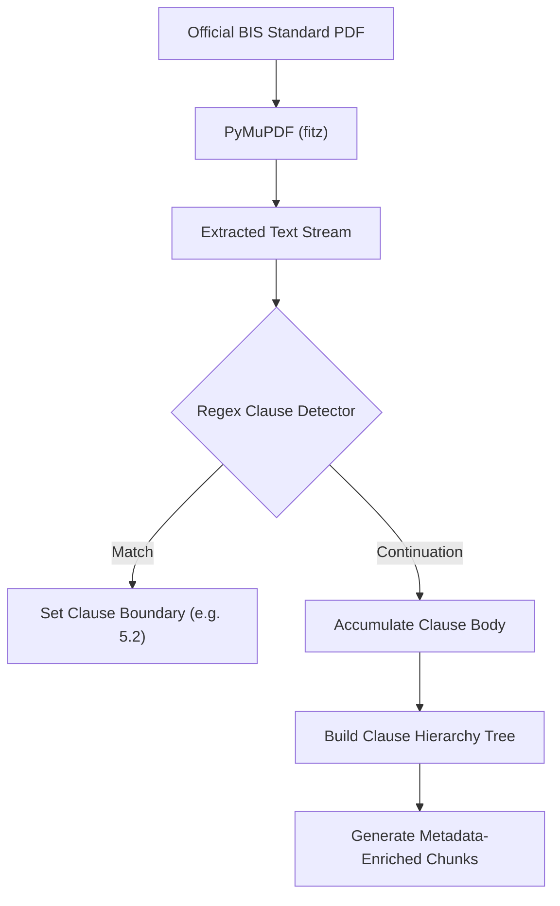

# Clause-Aware Chunking & Document Ingestion

## Purpose
Indian Standards are statutory, hierarchical engineering codes. Splitting documents using arbitrary token-length chunking destroys crucial clause context (such as parent sections, test methods, and pass/fail thresholds). The **Clause-Aware Hierarchical Chunker** extracts and preserves full clause lineages from raw BIS PDFs.

---

## System Architecture



---

## Data Flow

### Step 1: Document Parsing & Layout Cleaning
- **Purpose**: Remove headers, footers, page numbers, and watermark artifacts from scanned or digital BIS PDFs.
- **Input**: Standard PDF filepath or binary buffer.
- **Output**: Cleaned raw text pages.
- **Hook**: `PyMuPDF (fitz.open)`

### Step 2: Clause Header Detection
- **Purpose**: Identify standard section headers such as `1 SCOPE`, `2 REFERENCES`, `5 REQUIREMENTS`, `5.2 Mass`, `5.3 Impact Attenuation`.
- **Input**: Text lines.
- **Output**: Extracted clause number, title, and start byte position.
- **Hook**: Regex boundary detection.

### Step 3: Hierarchical Chunk Assembly
- **Purpose**: Attach parent section metadata to sub-clauses so isolated chunks retain full semantic meaning.
- **Input**: Sub-clause text.
- **Output**: Chunk text prefixed with standard title and parent clause hierarchy.
- **Hook**: `ClauseChunker.chunk_document()`

---

## Component Types

| Component | Responsibility | Technical Implementation |
| :--- | :--- | :--- |
| **PDF Ingestion Worker** | Opens and renders PDF document pages | `fitz.open()` (PyMuPDF) |
| **Clause Boundary Parser** | Detects hierarchical numbering levels | Regex pattern matcher |
| **Table & Formula Preserver** | Keeps tabular testing schedules intact | Markdown table converter |
| **Metadata Tagging Engine** | Enriches chunk records with standard details | Ingestion repository |

---

## Model Selection (3 Models Only)

### 1. Regex Clause Boundary Model
- **Model**: Multi-pattern statutory regular expression
- **Purpose**: Robust identification of BIS clause numbering schemes.
- **Input**: Page text line.
- **Output**: `{"clause_number": "5.2", "title": "Mass"}`.
- **Hook**: `ClauseChunker.detect_boundary()`

### 2. Parent Lineage Aggregator
- **Model**: Deterministic Tree Traversal
- **Purpose**: Reconstructs breadcrumbs: `IS 4151:2020 > Section 5 Requirements > 5.2 Mass`.
- **Input**: Flat list of detected clauses.
- **Output**: Hierarchical tree node.
- **Hook**: `ClauseChunker.build_tree()`

### 3. Chunk Normalization Model
- **Model**: Whitespace and Unicode Normalizer
- **Purpose**: Fixes OCR ligatures and hyphenated line breaks.
- **Input**: Raw text block.
- **Output**: Clean unicode string.
- **Hook**: `clean_text()`

---

## State Management

```typescript
export interface ClauseChunkState {
  standardNumber: string;
  revisionYear: number;
  totalClausesParsed: number;
  currentHierarchy: string[];
  chunksQueue: Array<{
    clauseNumber: string;
    clauseTitle: string;
    pageNumber: number;
    content: string;
  }>;
}
```

---

## Key Interactions

### 1. Ingestion Command Execution
- Operator runs seed ingestion:
  `python -c "from backend.ingestion.pipeline import pipeline; pipeline.run_seed_ingestion()"`

### 2. Clause Storage
- Each clause is committed to database `chunks` table with its exact clause number and page reference.

---

## File Structure

```text
backend/ingestion/
├── __init__.py
├── pipeline.py            # Master IngestionPipeline
├── dynamic_pipeline.py    # URL & dynamic PDF fetcher
├── bis_seed_data.py       # Seed catalog for 50+ essential standards
└── chunkers/
    └── clause_chunker.py  # ClauseChunker regex engine
```

---

## Integration Points

### Existing Hooks (Reuse)
- `pipeline.run_seed_ingestion()`: Executes end-to-end extraction and embedding generation.
