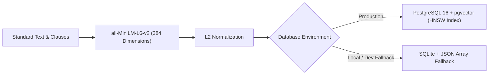

# Embeddings & Vector Storage

## Purpose
This document details the dense vector representation, embedding pipelines, and dual database storage architecture (PostgreSQL 16 with `pgvector` and zero-configuration SQLite vector fallback) implemented for the **BIS Intelligent Assistant**.

---

## System Architecture



---

## Data Flow

### Step 1: Text Preprocessing & Tokenization
- **Purpose**: Strip formatting artifacts from PyMuPDF, normalize uppercase alphanumeric standard codes, and truncate text to maximum token window.
- **Input**: Raw clause text string.
- **Output**: Cleaned text within 512 tokens.
- **Hook**: `embedding_service.preprocess(text)`

### Step 2: Compute Dense Embedding
- **Purpose**: Map technical clauses and user queries into a shared 384-dimensional continuous semantic space.
- **Input**: Batch of strings or single user query.
- **Output**: 384-element float vector.
- **Hook**: `embedding_service.embed_query(query)`

### Step 3: L2 Normalization & Index Lookup
- **Purpose**: Normalize embedding vectors to unit length so that inner product equals cosine similarity.
- **Input**: Raw embedding vector.
- **Output**: Unit vector of norm 1.0.
- **Hook**: `np.linalg.norm(vec)`

---

## Component Types

| Component | Technology | Specification |
| :--- | :--- | :--- |
| **Embedding Model** | `all-MiniLM-L6-v2` | 384 dimensions, sentence-transformers, PyTorch |
| **Primary Vector Store** | PostgreSQL 16 + `pgvector` | HNSW Index with cosine distance metric (`vector_cosine_ops`) |
| **Fallback Vector Store** | SQLite 3 | Embedded JSON array with vectorized NumPy cosine dot product |
| **ORM Vector Type** | SQLAlchemy Custom Type | `VectorType(dimensions=384)` handling seamless cross-engine serialization |

---

## Model Selection (3 Models Only)

### 1. Fast Semantic Embedding Model
- **Model**: `all-MiniLM-L6-v2`
- **Purpose**: Real-time query embedding with sub-15ms inference latency on CPU.
- **Input**: Query string.
- **Output**: 384-dimension float vector.
- **Hook**: `embedding_service.embed_query()`

### 2. Batch Passage Embedding Model
- **Model**: `all-MiniLM-L6-v2` (Batched Mode)
- **Purpose**: High-throughput offline ingestion of 50,000+ clauses.
- **Input**: Batch of clause text passages (batch size = 64).
- **Output**: Matrix of shape `(64, 384)`.
- **Hook**: `embedding_service.embed_documents(texts)`

### 3. PostgreSQL HNSW Indexing Engine
- **Model**: Hierarchical Navigable Small World (HNSW) graph index
- **Purpose**: Approximate nearest neighbor (ANN) search with logarithmic query complexity.
- **Input**: Query vector and limit k.
- **Output**: Top-k closest vector IDs.
- **Hook**: SQL query ordering by `embedding <=> :q LIMIT :k`.

---

## State Management

```typescript
export interface VectorStorageConfig {
  databaseType: 'POSTGRESQL' | 'SQLITE';
  vectorDimensions: 384;
  indexType: 'HNSW' | 'EXHAUSTIVE_FLAT';
  distanceMetric: 'COSINE';
  hnsw_m: 16;
  hnsw_ef_construction: 64;
}
```

---

## Key Interactions

### 1. Environment Auto-Detection
- On startup, `backend/database/connection.py` checks `DATABASE_URL`.
- If PostgreSQL is detected, activates `pgvector` extension and HNSW indexing.
- If SQLite is detected, switches to NumPy in-memory vector scanning without failing.

### 2. Fetch Vectors & Cosine Calculation
- `HybridSearchEngine` queries candidate chunks and computes cosine similarity.
- Candidates with similarity &ge; 0.35 are admitted to rank fusion.

### 3. Cache Management
- Embeddings for frequent statutory queries (`"motorcycle helmets"`, `"water heaters"`) are memoized in memory.

---

## File Structure

```text
backend/
├── database/
│   ├── models/
│   │   ├── standard.py       # Chunk model with embedding column
│   │   └── vector_type.py    # Custom SQLAlchemy vector type adapter
│   └── connection.py         # DB connection & pgvector extension init
└── rag/
    └── embeddings.py         # EmbeddingService singleton
```

---

## Integration Points

### Existing Hooks (Reuse)
- `embedding_service.embed_query()`: Direct inference for user queries.
- `embedding_service.embed_documents()`: Batch inference for new standard ingestion.

### Existing Types & Models (Reuse)
- `VectorType`: Cross-database abstraction supporting both Postgres `VECTOR(384)` and SQLite `TEXT/BLOB`.
