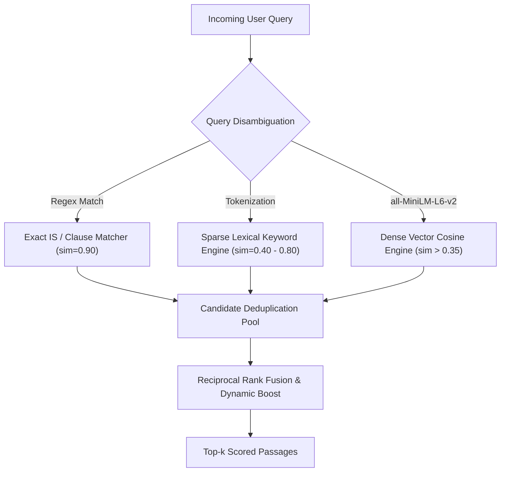

# Hybrid Retrieval Engine

## Purpose
The Hybrid Retrieval Engine combines dense semantic vector embeddings with sparse lexical keyword matching and exact alphanumeric regex filters. This eliminates false negatives on precise IS numbers (`IS 4151`, `IS 302-2-21`) while accurately handling colloquial, descriptive user requests.

---

## System Architecture



---

## Data Flow

### Step 1: Detect Explicit IS Numbers & Clause Designations
- **Purpose**: Identify if the user provided an explicit Indian Standard designation or clause number.
- **Input**: User query text.
- **Output**: Extracted standard code (e.g. `IS 4151:2020`) and target clause (e.g. `5.2`).
- **Hook**: Regex matching over query string.

### Step 2: Fetch Parameters & Candidate Generation
- **Purpose**: Run parallel retrieval across exact standard chunks, clause filters, and keyword token overlaps.
- **Input**: Query tokens and extracted codes.
- **Output**: Combined pool of candidate chunks with preliminary base scores.
- **Hook**: `HybridSearchEngine.search()`

### Step 3: Run Model & Reciprocal Rank Fusion (RRF)
- **Purpose**: Combine vector similarity ranks and keyword matching ranks into a single unified relevance score using `RRF = sum(1 / (k + rank))`.
- **Input**: Ranked candidate lists.
- **Output**: Final ordered candidate list sorted descending by fusion score.
- **Hook**: `reranker.rerank(candidates, query)`

---

## Component Types

| Component | Responsibility | Algorithm / Rule |
| :--- | :--- | :--- |
| **IS Regex Extractor** | Parses raw strings for statutory IS patterns | Pattern: `(?:IS\s*)?(\d{3,5}(?:\s*\(Part\s*\d+\))?(?::\d{4})?)` |
| **Clause Extractor** | Identifies specific clause requests | Pattern: `clause\s*(\d+(?:\.\d+)*)` |
| **Lexical Tokenizer** | Filters stop words and matches content terms | Length &gt; 2, excludes statutory stop words |
| **Dense Vector Scorer** | Dot product over unit-normalized embeddings | Cosine similarity dot product |

---

## Model Selection (3 Models Only)

### 1. Regex Alphanumeric Extractor
- **Model**: Deterministic Regular Expression Rule
- **Purpose**: Fast-path resolution for queries with explicit standard numbers.
- **Input**: Raw query.
- **Output**: Normalized IS string.
- **Hook**: `re.search`

### 2. Lexical Token Scorer
- **Model**: Token match frequency over normalized standard text
- **Purpose**: Matches specific technical terms (e.g., *"impact attenuation"*, *"mass threshold"*).
- **Input**: Filtered query tokens.
- **Output**: Score in range `[0.4, 0.8]`.
- **Hook**: `_format_chunk_candidate`

### 3. Dense Cosine Distance Model
- **Model**: `all-MiniLM-L6-v2` Cosine Similarity
- **Purpose**: Discovers standards based on product descriptions without statutory numbers.
- **Input**: 384-dimensional query vector.
- **Output**: Continuous score in range `[-1.0, 1.0]`.
- **Hook**: `np.dot(q_embed, doc_embed)`

---

## State Management

```typescript
export interface HybridSearchState {
  rawQuery: string;
  detectedIS: string | null;
  detectedClause: string | null;
  tokens: string[];
  candidatesCount: number;
  topCandidate: {
    standardNumber: string;
    clauseNumber: string;
    fusedScore: number;
  } | null;
}
```

---

## Key Interactions

### 1. Component Click
- User triggers search via `/api/search/hybrid` with `?q=helmets&top_k=5`.

### 2. Parameter Fetching
- Hybrid searcher pulls all chunks matching `IS 4151` and ranks by clause order.

### 3. Execution & Verification
- Top 5 chunks are verified to belong to Tier-1 authoritative standards.

---

## File Structure

```text
backend/rag/
├── hybrid_search.py       # HybridSearchEngine class
└── reranker.py            # Reranker scoring logic
```

---

## Integration Points

### Existing Hooks (Reuse)
- `hybrid_search_engine.search(query, standard_number, clause_number)`

### Existing Types (Reuse)
- `ChunkCandidate`: Formatted dictionary with `chunk_id`, `standard_number`, `clause_number`, `similarity`.
