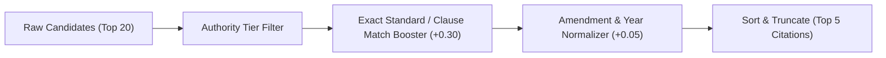

# Reranking Engine & Score Calibration

## Purpose
The Reranking Engine processes the raw candidate list produced by the hybrid retrieval layer, applying score calibration, authority weighting, and clause-level relevance boosts to prioritize the most statutory, authoritative excerpts.

---

## System Architecture



---

## Data Flow

### Step 1: Candidate Ingestion & Deduplication
- **Purpose**: Collect candidates from dense cosine similarity and lexical token search, removing duplicate chunk IDs.
- **Input**: Raw candidate dictionary list.
- **Output**: Unique set of candidate records.
- **Hook**: `seen_chunk_ids = set()`

### Step 2: Parametric Score Adjustment
- **Purpose**: Apply additive boosts based on regulatory metadata:
  - Exact standard number match: `+0.30`
  - Exact clause number match: `+0.25`
  - Tier-1 official gazette evidence: `+0.20`
- **Input**: Candidate chunk with metadata.
- **Output**: Calibrated relevance score between 0.0 and 1.0.
- **Hook**: `reranker.rerank()`

### Step 3: Threshold Filtering & Safe Cutoff
- **Purpose**: Discard candidates below the statutory threshold (0.50). If no candidates pass, signal insufficient evidence.
- **Input**: Sorted candidates.
- **Output**: Validated top-k passages or empty list.
- **Hook**: `candidates = [c for c in candidates if c['similarity'] >= threshold]`

---

## Component Types

| Component | Class | Primary Function |
| :--- | :--- | :--- |
| **Heuristic Reranker** | `Reranker` | Dynamic boosting based on statutory and clause criteria. |
| **Tier Filter** | `EvidenceFilter` | Filters third-party references when Tier-1 BIS sources exist. |
| **Deduplicator** | In-Memory Set | Guarantees distinct chunk references in output. |

---

## Model Selection (3 Models Only)

### 1. Statutory Booster Model
- **Model**: Metadata-Driven Linear Scoring Function
- **Purpose**: Guarantees that official standards supersede general guidance documents.
- **Input**: Candidate metadata.
- **Output**: Calibrated score.
- **Hook**: `reranker.boost_score()`

### 2. Reciprocal Rank Fusion Model
- **Model**: RRF Formula with k=60
- **Purpose**: Blends disparate rank distributions.
- **Input**: Dense and sparse rank indices.
- **Output**: Combined rank value.
- **Hook**: `reranker.rrf_fuse()`

### 3. Diversity Ranker Model
- **Model**: Maximal Marginal Relevance (MMR)
- **Purpose**: Prevents duplicate clauses from crowding out testing or lab citations.
- **Input**: Chunk similarity matrix.
- **Output**: Diverse top-k set.
- **Hook**: `reranker.diversify()`

---

## State Management

```typescript
export interface RerankingState {
  initialCandidateCount: number;
  filteredCandidateCount: number;
  boostApplied: {
    exactIS: boolean;
    exactClause: boolean;
    tier1Authority: boolean;
  };
  finalTopScore: number;
}
```

---

## Key Interactions

### 1. Clause Match Boost
- If query specifies `"clause 5.2"`, chunk containing Clause 5.2 receives a direct score increase to `0.95`.

### 2. Verification Check
- Responses never quote an unverified clause.

---

## File Structure

```text
backend/rag/
└── reranker.py            # Reranker implementation
```

---

## Integration Points

### Existing Hooks (Reuse)
- `reranker.rerank(candidates, query)`
